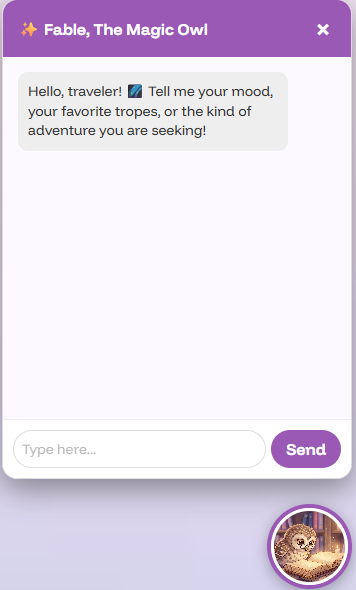
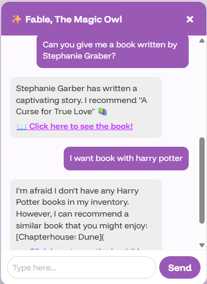
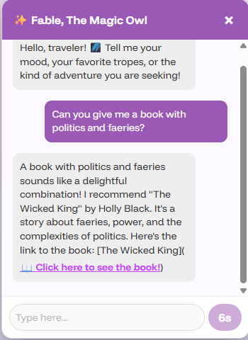
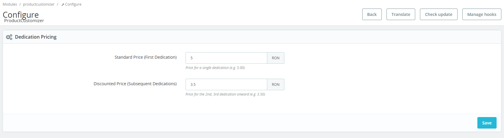
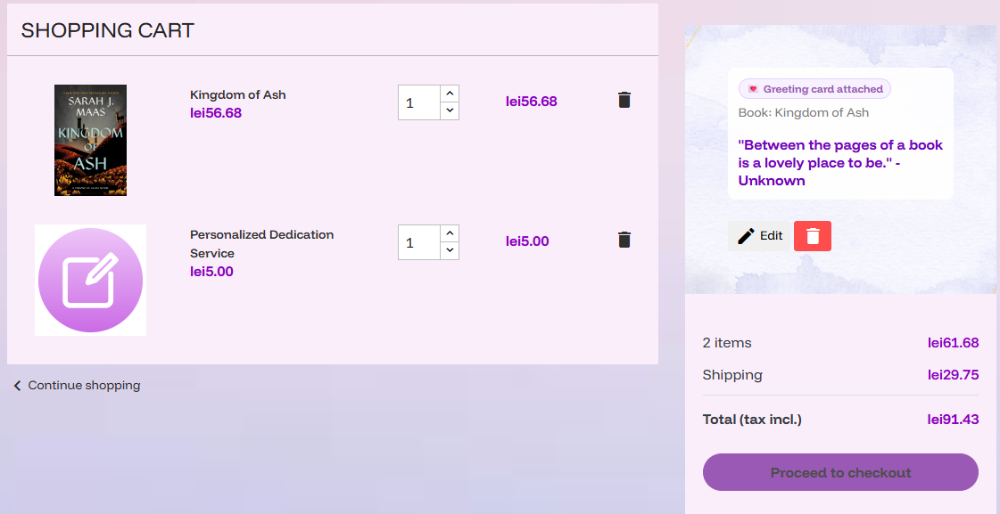
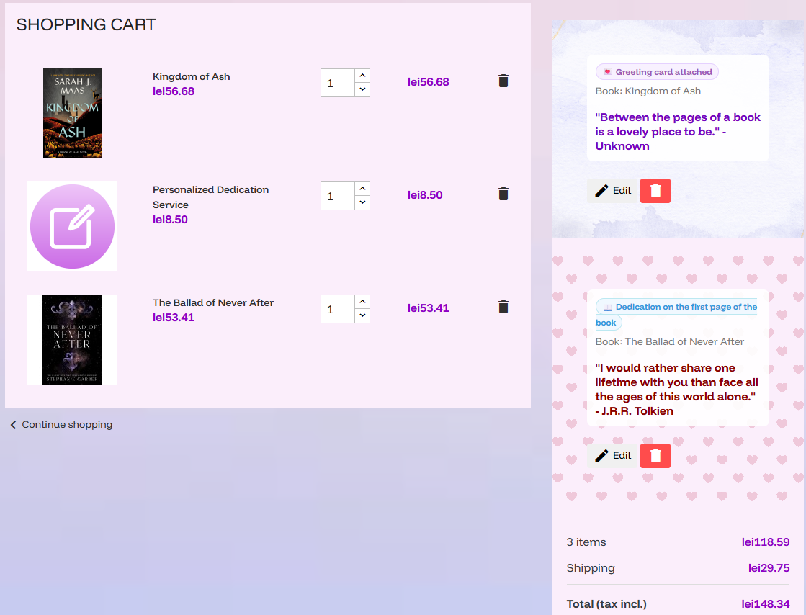
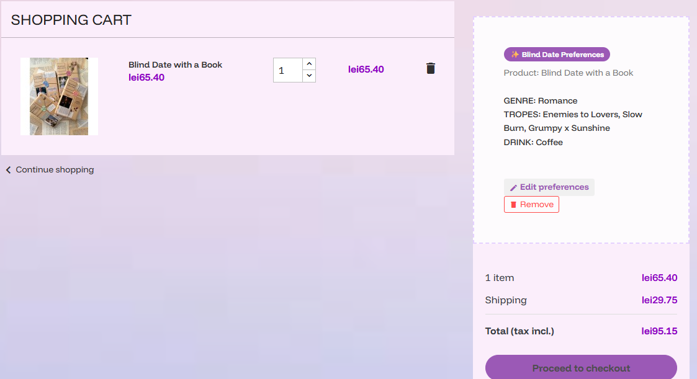
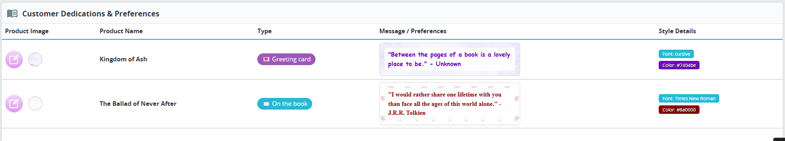
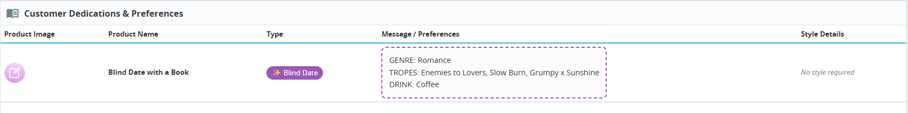

# 🦉 The Story Within - Smart E-Commerce Platform

**The Story Within** is an innovative e-commerce bookstore developed as a Bachelor's Thesis project. Built on top of the PrestaShop architecture, it transcends traditional online retail by integrating Generative AI, gamification, and real-time graphic customization to deliver a highly interactive user experience.

---

## ✨ Key Features & Visual Walkthrough

### 1. Fable, The Magic Owl (AI Shopping Assistant)
A conversational AI assistant powered by **Llama 3** (via **Groq API**) designed to act as a digital bookseller. 
* **RAG Architecture (Retrieval-Augmented Generation):** The AI dynamically reads the store's inventory and recommends *only* books that are currently in stock, preventing AI hallucinations.
* **Interactive UI:** AI responses are parsed via Regex to generate clickable HTML buttons directly in the chat window.

| |  |  |
|:---:|:---:|:---:|
| **1. Greeting & Personality** | **2. RAG Validation (Out of stock)** | **3. Real Recommendation & Link** |

### 2. Live Preview Product Customizer
A dynamic frontend module allowing users to create personalized book dedications.
* **Real-Time DOM Manipulation:** Render text, custom fonts (including cursive), and colors on the product mockup instantly.
* **FileReader API Integration:** Users can upload custom background images from their PC.

**Customizer Interface:**

**Dynamic DOM Updates (Live Preview):**
| |  |  |
|:---:|:---:|:---:|
| **Card Mode (Default)** | **Book Mode (Texture Update)** | **Custom Upload & Font** |

*(Note: The main product interface is available in `images/pagina_produs.png`)*

### 3. Dynamic Pricing Algorithm & Cart Integration
A custom backend PHP module that calculates customization fees dynamically in the cart, implementing a **Volume Discount Strategy**.
* The Admin configures the pricing rules in the custom module settings.
* The cart updates dynamically: charging the standard price for the first dedication and a discounted price for subsequent ones.

| |  |
|:---:|:---:|
| **Standard Fee for 1 Item** | **Discounted Fee applied for 2 Items** |

### 4. "Blind Date with a Book" (Gamification)
An interactive module where users configure their reading preferences (Genre, Tropes, Cozy Drink) instead of picking a specific title.
* Frontend validation limits user selections (e.g., max 3 tropes).
* Data is stored cleanly and bypasses the dynamic pricing algorithm.

| |  |
|:---:|:---:|
| **Step-by-step UI** | **Trope Selection Limit** |

### 5. Back-Office Operational Flow
To ensure business viability, the custom data is seamlessly integrated into the PrestaShop Admin Dashboard, allowing staff to fulfill orders efficiently without errors.

**Custom Dedication Details:**

**Blind Date Preferences:**

---

## 🛠️ Tech Stack

* **Backend:** PHP, MySQL (PrestaShop Core & Custom Modules)
* **Frontend:** JavaScript, jQuery, HTML5, CSS3, Smarty (Templates)
* **AI & API Integration:** Groq API, Meta Llama 3 (llama-3.1-8b-instant), cURL, JSON
* **Architecture:** MVC, Hooks, RAG (Retrieval-Augmented Generation)

## 🚀 Installation & Setup

### Prerequisites
* **PrestaShop** (Version 1.7.8 or higher) & **PHP** (7.4 or higher)
* A valid [Groq API Key](https://console.groq.com/) for the AI assistant.

### Step-by-Step Guide
1. **Module Installation:** Download this repository and copy the `productcustomizer` folder into the `/modules/` directory of your PrestaShop installation.
2. **Activation:** Log into your PrestaShop Back-Office. Navigate to *Modules -> Module Manager*, search for **ProductCustomizer**, and click **Install**. 
3. **Configure Pricing:** Click on "Configure" on the module to set your dynamic pricing rules.
4. **AI Setup:** Place the `fable-api.php` script in your desired directory. Open the file and replace `$apiKey = 'YOUR_GROQ_API_KEY_HERE';` with your actual key.

---

## 🎓 About
This project was developed by **Denisa Coman** as a Bachelor's Thesis for the Faculty of Economic Sciences and Business Administration, Transilvania University of Brașov (2026). It serves as a proof-of-concept for how modern web technologies and Artificial Intelligence can re-humanize the digital retail experience.
